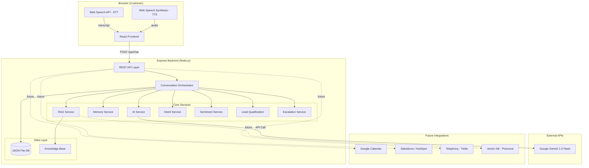
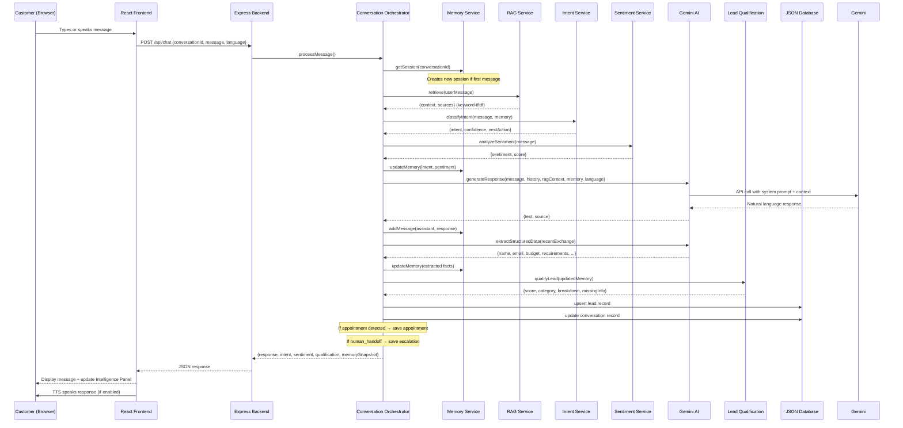

# System Architecture — NovaTech AI Sales Voice Agent

## Component Responsibilities

| Component | Responsibility |
|---|---|
| React Frontend | User interface: chat, voice controls, CRM views, analytics charts |
| Vite Dev Server | Frontend build tool and dev proxy |
| Express Backend | REST API, request routing, rate limiting, CORS |
| Conversation Orchestrator | Coordinates all services for one message turn |
| AI Service (Gemini) | Generates natural language responses; extracts structured data |
| Memory Service | Per-session in-memory context store (isolated per conversation ID) |
| RAG Service | Keyword TF-IDF retrieval from knowledge documents |
| Intent Service | Classifies customer intent; routes to appropriate next action |
| Sentiment Service | Keyword-based sentiment classification |
| Lead Qualification Service | Transparent 5-criterion scoring (max 100) |
| DB Service | JSON file persistence layer (swappable to MongoDB/PostgreSQL) |
| Appointment Service | Saves pending appointment requests |
| Analytics Route | Computes all metrics from real stored data |
| Escalation Service | Flags conversations for human handoff |

---

## High-Level Architecture Diagram



---

## Complete Sequence Diagram — One Customer Turn



---

## End-to-End Workflow (19 Steps)

| Step | Action | Component |
|---|---|---|
| 1 | Customer opens AI Sales Agent page | Frontend |
| 2 | Customer selects English or Hindi | Frontend language selector |
| 3 | Customer types or speaks a message | Web Speech API → Frontend |
| 4 | Agent greets naturally | Gemini + fallback response |
| 5 | Customer explains business requirement | User input |
| 6 | RAG retrieves relevant knowledge chunks | RAG Service (keyword-tfidf) |
| 7 | Agent responds using retrieved context | Gemini with RAG context |
| 8 | Memory stores facts from conversation | Memory Service |
| 9 | Agent asks qualification questions | Gemini guided by intent |
| 10 | Intent and sentiment are classified | Intent + Sentiment Services |
| 11 | Backend calculates qualification score | Lead Qualification Service |
| 12 | Agent offers a demo appointment | Gemini response |
| 13 | Customer provides contact details | Extracted by AI Service |
| 14 | Lead and appointment saved | DB Service |
| 15 | Conversation ends | POST /conversations/:id/end |
| 16 | Gemini generates summary | AI Service |
| 17 | Admin opens CRM dashboard | Frontend (Leads page) |
| 18 | Lead, score, sentiment, appointment visible | Real data from DB |
| 19 | Analytics recalculated from stored data | Analytics route |

---

## Data Flow for Lead Qualification Score

```
Customer message
       ↓
Memory Session (accumulated facts from entire conversation)
       ↓
qualifyLead(memory) →
  scoreRequirement(requirements)   → 0–20 pts
  scoreBudget(budget)              → 0–20 pts
  scoreTimeline(purchaseTimeline)  → 0–20 pts
  scoreBuyingIntent(intent)        → 0–20 pts
  scoreDecisionMaker(decisionMaker)→ 0–20 pts
                                     ─────────
                            Total:   0–100 pts

  ≥ 70 → Hot lead
  ≥ 40 → Warm lead
  < 40 → Cold lead
```

---

## RAG Pipeline (MVP Implementation)

```
Knowledge Base (12 documents)
       ↓
Chunking (300-word chunks, 50-word overlap)
       ↓
In-memory chunk index (60+ chunks)
       ↓
User query → tokenize → TF-IDF scoring against all chunks
       ↓
Top 4 chunks by relevance score
       ↓
Context injected into Gemini prompt
       ↓
Grounded response (agent only uses retrieved facts)

Production upgrade:
  ↳ Replace TF-IDF with Gemini Embedding API (text-embedding-004)
  ↳ Store vectors in Pinecone or pgvector
  ↳ Cosine similarity search for semantic retrieval
```

---

## Security Architecture

```
Browser → HTTPS (production) → CDN → Load Balancer
                                          ↓
                                    Express API
                                    - CORS whitelist
                                    - Rate limiting (30 req/min AI, 120 req/min general)
                                    - Input validation
                                    - No API keys in responses
                                          ↓
                                    Services
                                    - Session isolation (separate Map entries)
                                    - No cross-session data access
                                    - API key in env var only
                                          ↓
                                    JSON File DB
                                    - No customer PII in logs
                                    - Soft deletes preserve audit trail
```
