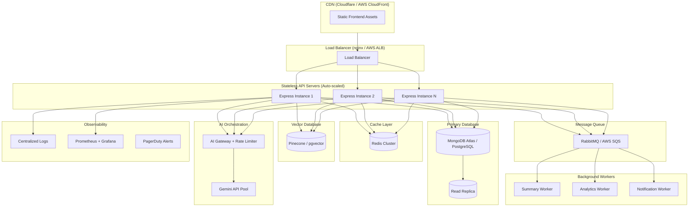

# Scalability Strategy — 100,000 Users

> ⚠️ The current MVP runs on a single Node.js process and JSON file storage.
> It is **not** designed for 100,000 users. This document describes a credible
> production architecture that could support that scale.

---

## Understanding the Load

**100,000 registered users ≠ 100,000 simultaneous users.**

| Metric | Realistic Assumption | Calculation |
|---|---|---|
| Registered users | 100,000 | — |
| Monthly Active Users (MAU) | 20% | 20,000 |
| Daily Active Users (DAU) | 10% of MAU | 2,000 |
| Peak concurrent conversations | 5% of DAU | 100 |
| Peak concurrent voice sessions | 2% of DAU | 40 |
| API requests per second (peak) | 100 convs × 1 msg/5s | ~20 RPS |
| AI API calls per second (peak) | Same as above | ~20 RPS |

This is very manageable with horizontal scaling.

---

## Production Architecture for 100,000 Users

---

## How Each Scaling Concern is Addressed

### 1. Request Distribution
- nginx or AWS ALB distributes requests in round-robin across API instances.
- API servers are stateless — no session data is stored in them.
- All shared state lives in Redis (sessions) and MongoDB (persistent data).

### 2. Session Management at Scale
- Replace in-memory Map with **Redis** for session storage.
- Sessions expire automatically via Redis TTL (e.g., 24 hours).
- Any API instance can serve any user because sessions are in shared Redis.

### 3. AI API Rate Limits
- Gemini API has per-project rate limits.
- An **AI Gateway** sits between API servers and Gemini:
  - Queues excess requests.
  - Implements exponential backoff on rate limit errors.
  - Distributes calls across multiple Gemini API keys (if permitted by ToS).
  - Caches identical queries (e.g., FAQ answers) in Redis for 15 minutes.

### 4. Background Processing
- Conversation summaries and analytics are expensive AI calls.
- These are pushed to a **message queue** (RabbitMQ / SQS) and processed asynchronously by background workers.
- Users get a "summary generating" indicator and retrieve it when ready.

### 5. Database Performance
- MongoDB with appropriate indexes on `conversationId`, `createdAt`, `leadCategory`.
- Read replicas for analytics queries (never query primary for heavy reads).
- Database connection pooling (Mongoose's default pool size = 5, increase to 20+).
- TTL indexes to auto-expire old session data.

### 6. Voice Traffic Scaling
- Browser Web Speech API (MVP) has zero backend load — STT/TTS happens in the browser.
- For telephony-grade voice (e.g., Twilio):
  - Each active call = one persistent WebSocket connection.
  - Use dedicated media server instances (separate from API servers).
  - Stream audio to Deepgram/Google Cloud Speech for real-time STT.
  - Autoscale media servers based on active call count.

### 7. Failure Recovery
- **Health checks**: Load balancer removes unhealthy instances automatically.
- **Redis failover**: Redis Sentinel or Redis Cluster for HA.
- **Database failover**: MongoDB Atlas automatic primary failover.
- **AI failures**: Fallback to keyword-based responses when Gemini is unavailable.
- **Circuit breaker**: Stop routing to Gemini if error rate > 10% (use opossum library).

### 8. Cost Control
- Use Gemini Flash (not Pro) for most conversations — 10x cheaper.
- Cache common answers (product FAQs) in Redis — avoids AI call entirely.
- RAG limits context to 4 chunks (~1200 tokens) instead of sending full knowledge base.
- Background workers process during off-peak hours.
- Auto-scale down API instances during night hours.
- Set hard token limits (maxOutputTokens: 400) to control per-call costs.

---

## Infrastructure Cost Estimate (100,000 Users, MVP → Production)

| Item | MVP (Single Machine) | Production (100K users) |
|---|---|---|
| Compute (3 API instances) | $0 (local) | ~$150/month |
| Redis (Upstash or ElastiCache) | $0 | ~$30/month |
| MongoDB Atlas M10 | $0 (JSON file) | ~$57/month |
| Gemini API (20K calls/day) | Per-use | ~$150/month* |
| CDN + Load Balancer | $0 | ~$30/month |
| Monitoring (Grafana Cloud) | $0 | ~$0 (free tier) |
| **Total** | **~$0** | **~$420/month** |

*Assumes Gemini 1.5 Flash pricing. Verify current pricing at ai.google.dev/pricing.
These are estimates based on assumed usage patterns, not guaranteed costs.
